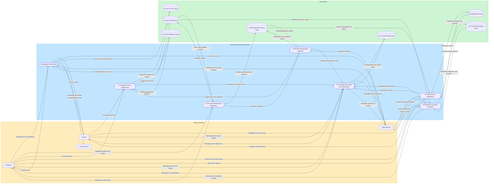

# Rush Fitness Gym — Data Flow Diagram Level 1

This Level 1 DFD is derived from the Laravel routes, controllers, models, and migrations in the Rush Fitness Gym system.

## Diagram code

## Data-store mapping

| Store | Name | Database tables |
|---|---|---|
| D1 | User Access Data | `users`, `password_reset_tokens`, `sessions` |
| D2 | Gym Profile Data | `members`, `coaches`, `membership_plans` |
| D3 | Membership Finance Data | `subscriptions`, `transactions` |
| D4 | Coach Assignment Data | `coach_assignment_requests` |
| D5 | Coaching Schedule Data | `coach_availability_changes`, `availability_slots`, `schedule_events`, `coach_client_records` |
| D6 | Attendance Data | `attendances` |
| D7 | Communication Data | `messages`, `notifications` |

Message and receipt binaries are stored through Laravel's configured filesystem. Their paths and attachment metadata are retained in the `messages` and `transactions` tables.

## Process table

| Process No. | Process Name | Inputs | Outputs | Data Stores Used |
|---|---|---|---|---|
| 1.0 | Manage User Access | Member registration/login details; coach and administrator credentials/profile changes; stored credentials, roles, and sessions | Role-based access results; updated account/session data; password-reset code sent to the email service | D1 — `users`, `password_reset_tokens`, `sessions` |
| 2.0 | Process Membership Application | Member profile, selected plan/coach, payment details, receipt; active plans and available coaches | Member profile; pending subscription and transaction; review package; submission confirmation | D2 — `members`, `coaches`, `membership_plans`; D3 — `subscriptions`, `transactions` |
| 3.0 | Review Membership Approval | Administrator decision; pending membership, payment, and receipt details | Approved/declined subscription and payment status; optional coach request; membership decision event | D3 — `subscriptions`, `transactions` |
| 4.0 | Manage Coach Assignment | Member coach selection; coach decision; coach request from approved application; pending requests | Assignment request/review status; assigned coach link; assignment decision event | D4 — `coach_assignment_requests`; D2 — `members`, `coaches` |
| 5.0 | Maintain Coaching Schedule | Coach availability and client notes; administrator schedule decision; member calendar/record query; roster and stored schedule data | Availability changes; approved slots; calendar events; coaching records; calendar/client views; schedule decision event | D5 — `coach_availability_changes`, `availability_slots`, `schedule_events`, `coach_client_records`; D2 — `members`, `coaches` |
| 6.0 | Record Gym Attendance | Member QR request; administrator-scanned QR value; active subscription/access token; existing daily attendance | QR/access validation result; daily attendance record; administrator check-in result; attendance event | D3 — `subscriptions`; D6 — `attendances` |
| 7.0 | Exchange Messages and Notifications | Member, coach, and administrator messages/media; membership, assignment, schedule, and attendance events; stored conversations and alerts | Stored messages/alerts; conversations; unread alerts; delivered messages and notifications | D7 — `messages`, `notifications` |

## DFD rule check

- Every process has at least one input and one output.
- Every data flow is labeled.
- No external entity connects directly to another external entity.
- No data store connects directly to another data store.
- External entities interact with data stores only through numbered processes.

